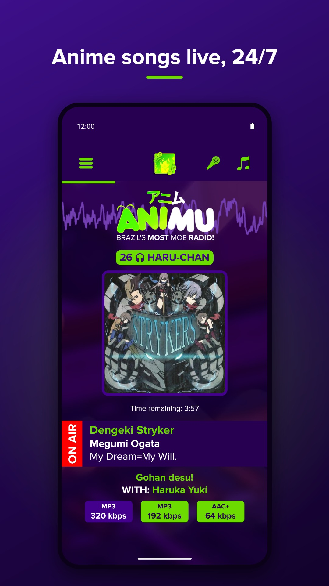
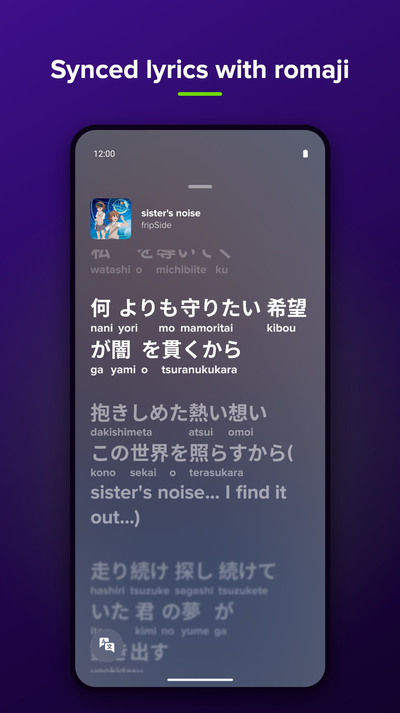
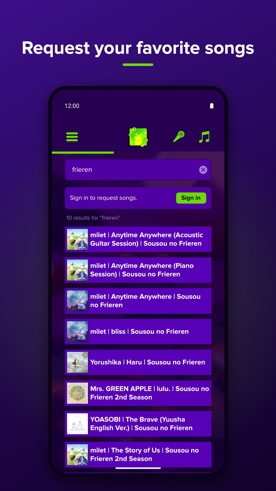
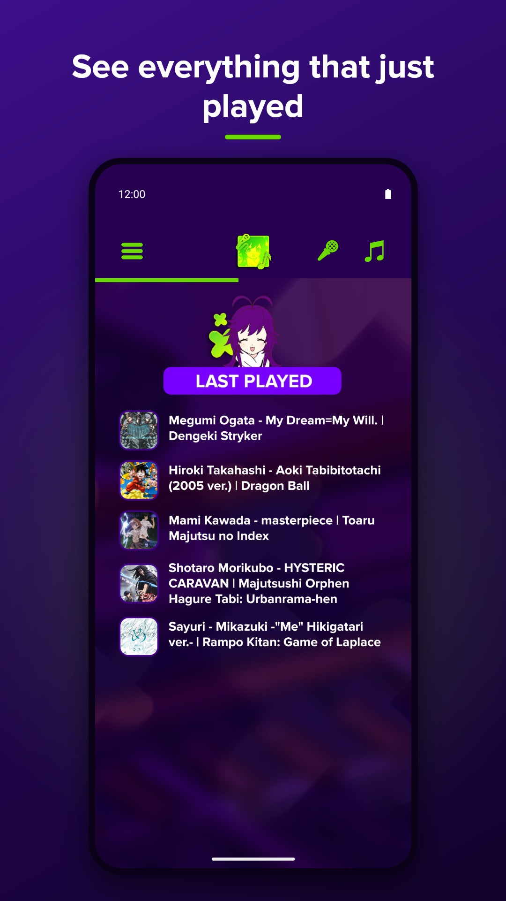
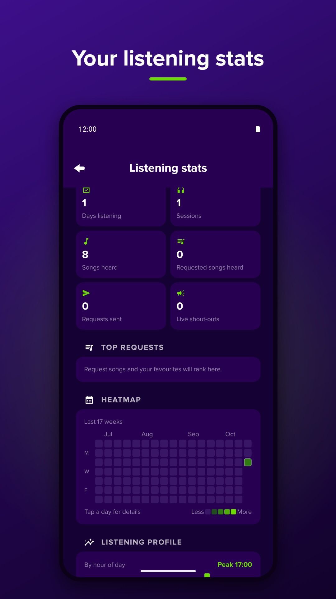
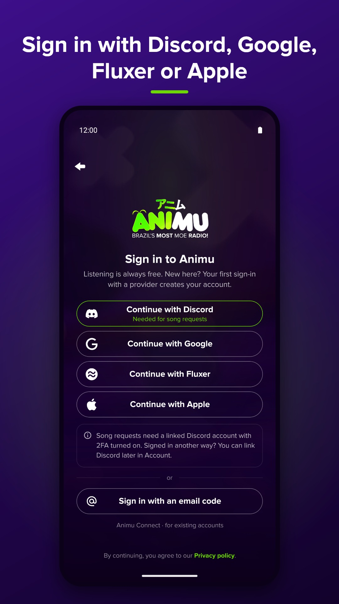
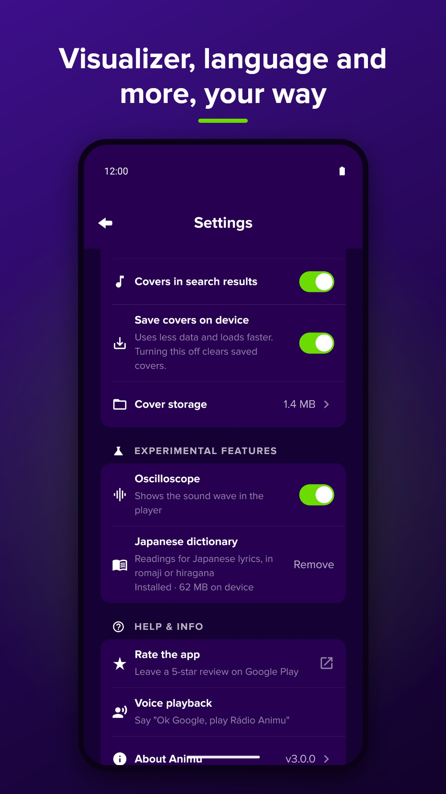
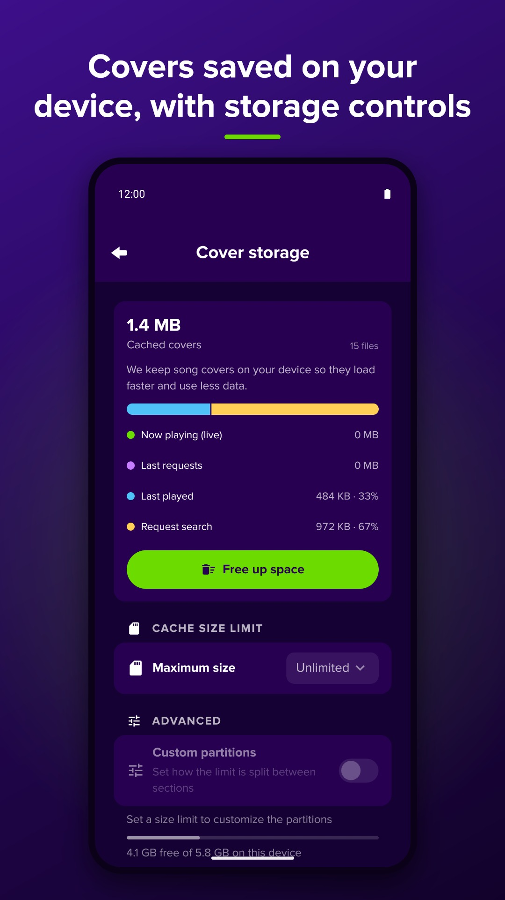

# Animu Mobile App

> The official mobile client for [Rádio Animu](https://www.animu.moe) — Brazil's most moe radio.

[](https://github.com/RadioAnimu/animu-mobile-app/releases)
[](https://reactnative.dev)
[](https://expo.dev)
[](https://www.typescriptlang.org)
[](https://play.google.com/store/apps/details?id=com.nessjs.animu)
[](LICENSE)

Founded on April 16, 2018, **Rádio Animu** is a non-profit Brazilian radio dedicated to otaku culture — anime songs, openings and endings, fansings, remixes, rhythm-game music, vocaloid and more, with a live DJ schedule, listener-driven requests and a Discord community.

This repository is the official mobile application: a real-time internet-radio client built on React Native and Expo that mirrors the live station state — current track, cover art, live program, listener count and request history — while keeping audio streaming and accurate now-playing metadata alive in the background.

- **Android** — [Google Play Store](https://play.google.com/store/apps/details?id=com.nessjs.animu) (`com.nessjs.animu`)
- **iOS** — in development · sideload via the [AltStore source](docs/ALTSTORE.md)
- **Website** — [animu.moe](https://www.animu.moe) · [animu.com.br](https://www.animu.com.br)

<p align="center">
  <a href="https://play.google.com/store/apps/details?id=com.nessjs.animu">
    
  </a>
</p>

<table align="center">
  <tr>
    <td></td>
    <td></td>
    <td></td>
    <td></td>
  </tr>
  <tr>
    <td></td>
    <td></td>
    <td></td>
    <td></td>
  </tr>
</table>

<p align="center"><sub>
  Store screenshots in every listing language:
  <a href="store/google-play/pt-BR/images/phoneScreenshots">pt-BR</a> ·
  <a href="store/google-play/en-US/images/phoneScreenshots">en-US</a> ·
  <a href="store/google-play/pt-PT/images/phoneScreenshots">pt-PT</a> ·
  <a href="store/google-play/es-419/images/phoneScreenshots">es-419</a> ·
  <a href="store/google-play/ja-JP/images/phoneScreenshots">ja-JP</a>
</sub></p>

---

## Highlights

- **Live radio streaming** — selectable 320/192 kbps MP3 and 64 kbps AAC+, with dynamic stream discovery and a fallback list.
- **True now-playing everywhere** — the track you *hear* (the stream's ICY title, delivered when audible, matched to the station API) with its real progress on the lock screen and notification, plus background playback on both platforms.
- **Synced lyrics** — an Apple Music-style, line-by-line view of the song being heard, from [LRCLIB](https://lrclib.net), with **romaji or hiragana** readings for Japanese lyrics (on-device dictionary, optional download).
- **Audio visualizer (iOS and Android)** — an oscilloscope fed by the player's own decoded audio and drawn by the web player's own canvas loop in a transparent WebView, with **no microphone permission**.
- **Optional accounts** — Discord, Google, Apple, Fluxer and Animu Connect (passwordless email codes), with profile, avatar and provider management. Playback works anonymously.
- **Requests** — search and request tracks, and send live shout-outs to the DJ panel.
- **Listening stats** — time listened, songs heard, a listening heatmap and profile, kept on the device, plus a shareable card when signed in.
- **History & preferences** — last requested / last played lists, cover-art quality per view, a managed on-device cover cache, haptics and PT / EN / ES / JP localisation.
- **Voice assistants and cars** — "Ok Google, play Rádio Animu" on Android, "Hey Siri, play Rádio Animu" on iOS, and the station in Android Auto.
- **Offline resilience** — native reconnects (stalls, dead sockets, network handoffs, outages) that keep working with the app in the background, plus exponential-backoff API retries.

Read the full, screen-by-screen breakdown in **[Features](docs/FEATURES.md)**.

## Tech stack

React Native 0.86 (New Architecture) · React 19 · Expo SDK 57 · TypeScript 6
(strict) · React Navigation 7 (drawer + native stack) · `react-native-anything-player`
(native player) · `expo/fetch` · `react-native-webview` (visualizer)
· custom `useSyncExternalStore` stores · Vitest.
See **[Architecture](docs/ARCHITECTURE.md)** for the full picture.

## Quick start

```bash
git clone --recurse-submodules https://github.com/RadioAnimu/animu-mobile-app.git
pnpm install
pnpm run android   # or: pnpm run ios
pnpm test          # vitest
pnpm run lint      # expo lint
```

Requires Node 20+, pnpm (`corepack enable`) and a device/emulator with network
access to `animu.moe`. The
**Proxima Nova** fonts are not committed — see
[Development](docs/DEVELOPMENT.md#fonts).

## Documentation

| Doc | What's inside |
| --- | --- |
| [docs/](docs/README.md) | Documentation index |
| [Features](docs/FEATURES.md) | Every capability, screen by screen |
| [Architecture](docs/ARCHITECTURE.md) | Layers, player core, stores, key decisions |
| [Development](docs/DEVELOPMENT.md) | Setup, scripts, tests, aliases, patches, fonts |
| [Build & Release](docs/BUILD_AND_RELEASE.md) | EAS profiles, versioning, voice assistants |
| [API Surface](docs/API_SURFACE.md) | Station endpoints and the `animu-api` submodule |
| [AltStore](docs/ALTSTORE.md) | Self-hosted iOS distribution |
| [Store Submission](docs/STORE_SUBMISSION.md) | Master checklist and data inventory |
| [App Store Review Notes](docs/APP_STORE_REVIEW_NOTES.md) | Apple review notes + App Privacy |
| [Play Store Review Notes](docs/PLAY_STORE_REVIEW_NOTES.md) | Play Data safety + content rating |
| [Google Play listing](store/google-play/README.md) | Store listing, release notes and screenshots in every language |

## Roadmap

- [ ] iOS release on the App Store
- [ ] Push notifications for program/live events
- [ ] Expanded localization coverage

## License

The app's source code is [MIT](LICENSE) © 2023 RadioAnimu. The MIT license
covers the source code only — see [NOTICE](NOTICE). The `animu-api` submodule is
a separate MIT-licensed repository.
